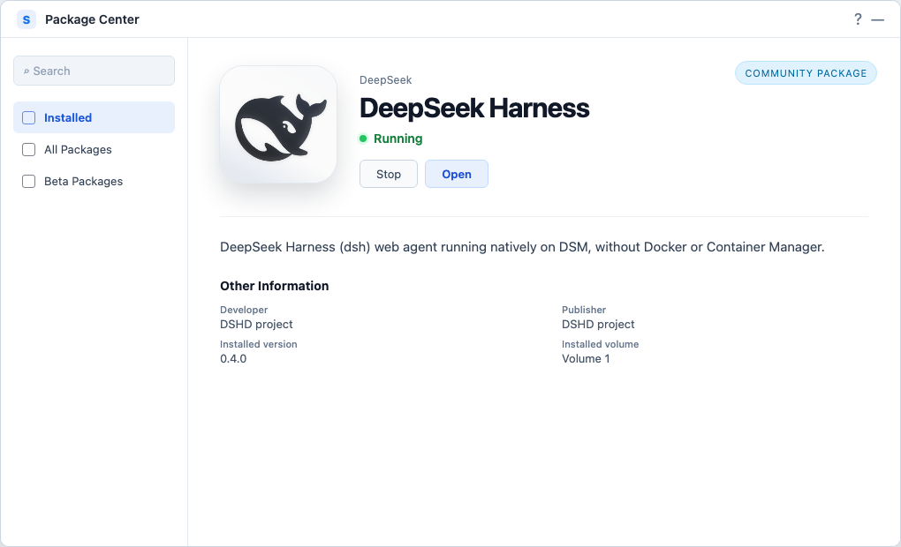

# DeepSeek Harness for Synology DSM

**Run DeepSeek Harness (dsh) natively on your NAS — no Docker, no Container Manager, no nested containers.**

[](#requirements)
[](#downloads)
[](#architecture)
[](LICENSE)
[](https://github.com/openviewmobile/dshd-synology-spk/actions/workflows/build-and-release.yml)

This package runs the [DeepSeek Harness](https://github.com/deepseek-ai) web agent as a
Synology DSM 7.2 package. The `0.4.0` native package runs a bundled Node 24 runtime
as the unprivileged package user, listens only on loopback, and is managed from
Package Center like any other DSM package.



**Repository:** [github.com/openviewmobile/dshd-synology-spk](https://github.com/openviewmobile/dshd-synology-spk)

## Why native?

| | Docker package (`0.3.0`, legacy) | Native package (`0.4.0`, recommended) |
|---|---|---|
| Runtime | Container Manager + `docker-project` worker | Native Node process as `dshd` |
| NAS requirements | Container Manager, Docker image | DSM 7.2+, no Docker |
| Install path | worker-created Compose project | ordinary SPK lifecycle scripts |
| Data | `target/compose/data` (replaced on upgrade) | `/volume1/@appdata/dshd/native` |
| VirtualDSM (no KVM) | worker timeout during first start | verified install/start/stop |
| Attack surface | Docker socket / worker | package user + loopback + token |

The native package keeps the useful parts of DSM integration:

- Package Center install, upgrade, start, stop, uninstall, and boot auto-start.
- Port registration and a `dshd` CLI for status, token, logs, and diagnostics.
- A first-run token URL written with mode `0600`; the package never prints a fake
  success when the token is missing.
- A default workspace that works on DSM, where `xdg-user-dir` is unavailable.
- A local-only security model: dsh binds `127.0.0.1`; publish it through the DSM
  reverse proxy if you need remote access.

## Downloads

| Package | Architecture | Notes |
|---|---|---|
| [`dshd-0.4.0.spk`](https://github.com/openviewmobile/dshd-synology-spk/releases/download/v0.4.0/dshd-0.4.0.spk) | x86_64 | tested on VirtualDSM 7.2 |
| [`dshd-0.4.0-armv8.spk`](https://github.com/openviewmobile/dshd-synology-spk/releases/download/v0.4.0/dshd-0.4.0-armv8.spk) | armv8 | built and CLI-checked; ARM DSM boot not yet verified |

The SPKs are unsigned community packages. DSM will show a third-party package
warning; review the source and build it yourself if you need a reproducible artifact.
See [docs/release/release-notes-0.4.0.md](docs/release/release-notes-0.4.0.md) for
checksums and known limitations.

## Requirements

- Synology DSM **7.2-64570 or newer**.
- **x86_64** or **armv8** NAS.
- About **1 GB** free space for the installed runtime (the SPK is ~213 MB).
- A writable `/volume1` (or another `/volume*` volume) for dsh home and workspace.
- No Container Manager, Docker, Node.js, or npm on the NAS.
- `/dev/shm` must be present and executable. DSM blocks `mmap(PROT_EXEC)` from
  `/volume1` and `/tmp`; the package uses a private `/dev/shm/dshd` directory for native
  addon materialization.

## Install

1. Download the SPK for your NAS architecture.
2. Open **Package Center → Manual Install** and select the file.
3. Accept the third-party package warning.
4. Keep the defaults, or choose a dsh home and workspace under `/volume*`.
5. Start **DeepSeek Harness** and open the token URL:

```bash
sudo /usr/local/bin/dshd-token
# or
sudo /usr/local/bin/dshd status
```

The token URL looks like:

```text
http://127.0.0.1:3080/?token=...
```

Open it from a browser on the NAS, or publish the UI through a reverse proxy.
The token rotates when the package restarts.

### CLI

```bash
dshd status
dshd token
dshd logs 200
dshd doctor
dshd restart
```

`dshd doctor` checks the bundled runtime, data/workspace permissions, the loopback
port, the token file, and the HTTP response.

## Architecture

```text
Package Center
  └─ /var/packages/dshd/scripts/start-stop-status
       └─ user dshd → target/runtime/node
            └─ dsh web --patch <workspace overlay>
                 --host 127.0.0.1 --port 3080
                 ├─ home:      /volume1/@appdata/dshd/native/home
                 ├─ workspace: /volume1/@appdata/dshd/native/workspace
                 └─ token:     /var/packages/dshd/var/token-url.txt (0600)
```

The package bundles the official Node 24 runtime and `@deepseek-ai/dsh`; it does
not use DSM's Node or download anything at runtime. The build uses Docker only to
extract a reproducible Linux runtime — the installed package does not depend on
Docker.

### Default workspace fix

dsh normally creates its first workspace under `<Documents>/deepseek-harness/default-workspace`.
DSM has no `xdg-user-dir`, so the package:

1. writes a read-only overlay `var/dshd-workspace.patch.yml` that sets
   `workspace-controller.documentsDirectory` to the package home;
2. symlinks `<home>/deepseek-harness/default-workspace` to `DSHD_WORKSPACE_DIR`.

This removes the "Unable to create default workspace" error on first launch.

## Configuration

Edit `/var/packages/dshd/var/config.env` and restart the package.

| Variable | Default | Purpose |
|---|---|---|
| `DSHD_DATA_DIR` | `/volume1/@appdata/dshd/native/home` | dsh home |
| `DSHD_WORKSPACE_DIR` | `/volume1/@appdata/dshd/native/workspace` | agent workspace |
| `DSHD_PORT` | `3080` | loopback port |
| `DSH_PUBLIC_URL` | `http://127.0.0.1:3080` | public origin used in token URLs |
| `DSH_TRUSTED_HOST` | `127.0.0.1` | dsh Host/Origin allowlist |
| `DSHD_START_TIMEOUT` | `300` | seconds to wait for the token |

Data and workspace paths must be absolute, under `/volume*` or the package var
directory, and must not contain `..`. The start script parses a whitelist of keys;
it never sources or evaluates `config.env`.

## Reverse proxy

In **Control Panel → Login Portal → Advanced → Reverse Proxy**:

- Source: HTTPS, your domain, 443.
- Destination: HTTP, `127.0.0.1`, `3080`.
- Enable WebSocket headers.

Then set:

```ini
DSH_PUBLIC_URL=https://dsh.example.net
DSH_TRUSTED_HOST=dsh.example.net
```

**Subpath caveat:** DSM's server-level static regex can intercept `/assets/*.js`.
Use a `^~` prefix location so the whole subpath goes to the proxy:

```nginx
location = /dshd { return 301 /dshd/; }
location ^~ /dshd/ {
    proxy_pass http://127.0.0.1:3080/;
    proxy_http_version 1.1;
    proxy_set_header Host $http_host;
    proxy_set_header X-Real-IP $remote_addr;
    proxy_set_header X-Forwarded-For $proxy_add_x_forwarded_for;
    proxy_set_header X-Forwarded-Proto $scheme;
    proxy_set_header Upgrade $http_upgrade;
    proxy_set_header Connection $connection_upgrade;
    proxy_buffering off;
    proxy_read_timeout 3600s;
    proxy_send_timeout 3600s;
}
```

Do not expose port 3080 on your router or LAN.

## Build

Docker is required **at build time only**, to extract the Node + dsh runtime.

```bash
# x86_64
make native-runtime
make native-spk
make native-check

# armv8
make native-armv8-runtime
make native-armv8-spk
```

Outputs:

```text
dist/dshd-0.4.0.spk
dist/dshd-0.4.0-armv8.spk
```

See [spk-native/README.md](spk-native/README.md) for the full build, migration, and
troubleshooting guide.

## Verification status

Verified on VirtualDSM 7.2 (QEMU TCG, no KVM):

- Package Center install/uninstall UI, start/stop, boot auto-start.
- Native CLI lifecycle, token permissions, doctor, logs.
- dsh Web UI, WebSocket through a subpath reverse proxy, settings pages, default
  workspace.
- x86_64 and armv8 artifact structure; armv8 `dsh --version` in an arm64 container.

Not yet verified:

- Real DSM hardware (x86_64 or armv8).
- A full chat turn against a real model API (no API key was configured).
- The install wizard's final **Apply** click; the wizard fields/Agree flow were
  verified, and installation was completed with `synopkg install`.
- Docker-to-native migration with a real legacy data volume; the config/directory
  migration path was rehearsed.
- DSM Control Panel reverse-proxy GUI/TLS; the equivalent nginx/WebSocket path was
  tested manually.

Full evidence and screenshots: [docs/testing.md](docs/testing.md).

## Launch video

A 50-second launch video is included as source (`promo-video/`). It is built with
Hyperframes and a deterministic three.js background; see
[`promo-video/`](promo-video/README.md) for the storyboard, rebuild commands,
captions, thumbnail, and upload metadata. The normalized MP4 is in the local
`promo-video/renders/` folder; the YouTube upload link will be added here after
publication.

## Legacy Docker package (`0.3.0`)

`spk/` contains the older Container Manager implementation. It is kept for
history and for NAS setups where the native package is not suitable. It uses the
`docker-project` worker, requires a locally loaded image, and has a documented
VirtualDSM worker-timeout limitation. See [spk/README.md](spk/README.md) and
[docs/spk.md](docs/spk.md).

## Repository layout

```text
spk-native/       0.4.0 native package (recommended)
spk/              0.3.0 Docker package (legacy)
scripts/          build-image, native-runtime, checks, lifecycle tests
docs/             design notes, ADRs, acceptance evidence
promo-video/      Hyperframes + three.js YouTube promo project
dist/             built SPKs (gitignored)
Dockerfile        runtime image used at build time
```

## Contributing

Issues and pull requests are welcome. Read [CONTRIBUTING.md](CONTRIBUTING.md) and
[SECURITY.md](SECURITY.md) before opening a security-sensitive report. For
release packaging, see [docs/release/github-publishing.md](docs/release/github-publishing.md).

## License

MIT. The package redistributes Node.js and `@deepseek-ai/dsh`; see
[THIRD_PARTY_NOTICES.md](THIRD_PARTY_NOTICES.md).
